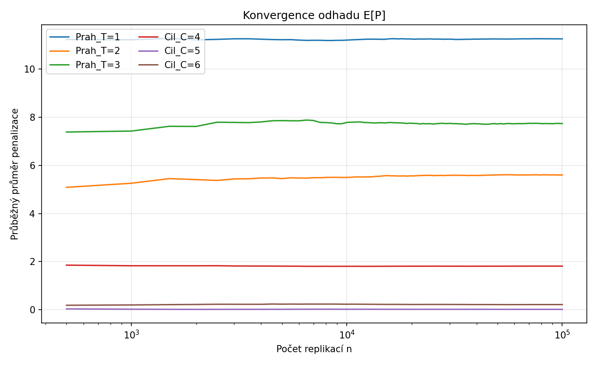
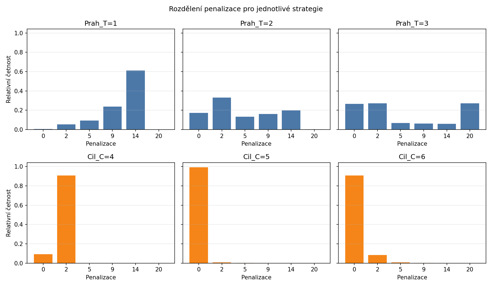

# Optimalizace strategie výběru sedadla při nástupu do letadla metodou Monte Carlo

Modelování a simulace (KST/BMOSI) – semestrální práce A, 2026/2027
Autor: Donbaeva Aidai st75700

## 1. Zadání a cíl

Cestující nastupuje do letadla s 10 řadami po 3 sedadlech. Prochází řady postupně od řady 1 k řadě 10, v každé řadě vidí pouze počet volných míst a rozhoduje se, zda se posadí, nebo půjde dál. Zpět se vrátit nemůže. Nejlepší komfort je ve středu letadla (řady 5 a 6). Kvalita rozhodnutí se měří penalizační funkcí P(r).

Cílem je porovnat dvě rozhodovací strategie a jejich parametry a najít variantu s nejmenší střední penalizací E[P] odhadnutou metodou Monte Carlo. Úloha je řešena ve vyšším programovacím jazyce (C#) i v simulačním nástroji Arena.

## 2. Popis modelu

**Počet volných míst v řadě** je náhodná veličina s binomickým rozdělením Binom(3, p):

| Řady | p |
|---|---|
| 1–3 | 0,3 |
| 4–7 | 0,6 |
| 8–10 | 0,5 |

**Porucha sedadla:** v každé řadě je s pravděpodobností 0,10 jedno místo nefunkční (Bernoulliho pokus nezávislý pro každou řadu). Počet využitelných míst se sníží o 1, minimálně však na 0. Pořadí v modelu: nejprve se vygeneruje binomická hodnota, potom se případně odečte porucha.

**Penalizace P(r):**

| Řada obsazení | P |
|---|---|
| 5 nebo 6 | 0 |
| 4 nebo 7 | 2 |
| 3 nebo 8 | 5 |
| 2 nebo 9 | 9 |
| 1 nebo 10 | 14 |
| místo neobsazeno | 20 |

**Jedna replikace** = jeden cestující, který projde letadlem. Výsledná penalizace se zaznamená a střední hodnota E[P] se odhaduje jako průměr přes N replikací.

**Strategie:**

- **Strategie 1 – Práhová (Threshold):** cestující obsadí první řadu, ve které je volných míst alespoň T. Parametr T ∈ {1, 2, 3}.
- **Strategie 2 – Cílová (Target):** cestující ignoruje řady před cílovou řadou C. V řadě C se posadí, pokud je tam volné místo, jinak obsadí první následující řadu s alespoň jedním volným místem. Parametr C ∈ {4, 5, 6}.

Dohromady se tedy porovnává 6 variant.

## 3. Implementace v C#

Složka `src/` (projekt .NET 6+):

| Soubor | Obsah |
|---|---|
| `Model.cs` | parametry modelu, generování volných míst v řadách (Binom + porucha), penalizační tabulka |
| `Strategies.cs` | funkce `Threshold(free, T)` a `Target(free, C)` |
| `Program.cs` | Monte Carlo smyčka, statistiky, export výsledků do CSV |

Důležité vlastnosti řešení:

- **Opakovatelnost pokusů:** generátor náhodných čísel je inicializován pevným seedem `12345`, každé spuštění dá stejné výsledky.
- **Společná náhodná čísla:** v každé replikaci se vygeneruje jedno „letadlo“ (volná místa ve všech řadách) a stejné letadlo se vyhodnotí všemi šesti strategiemi. Srovnání strategií je tak férové a má menší rozptyl.
- **Počet replikací:** N = 100 000.
- **Výstupy:** `results/results.csv` (průměr, směrodatná odchylka, 95% interval spolehlivosti), `results/running_mean.csv` (průběžný průměr pro graf konvergence), `results/histogram.csv` (relativní četnosti penalizace).

Spuštění:

```
cd src
dotnet run
```

## 4. Implementace v Areně

Složka `Arena/` obsahuje dva modely:

- `SeatMC.doe` – práhová strategie (proměnná `T`),
- `SeatMC_target.doe` – cílová strategie (proměnná `Cil`).

Jedna entita (`Cestujici`) představuje jednoho cestujícího. Model nepracuje s časem, proto modul **Create** generuje entity s konstantním intervalem 1 minuta a omezeným počtem příchodů (Max Arrivals = 100 000). Počet příchodů odpovídá počtu replikací Monte Carlo.

**Proměnné:** `T` (práh, resp. `Cil` – cílová řada), `Row` (aktuální řada), `VolnaMista` (volná místa v aktuální řadě; název `Free` Arena odmítla jako rezervované slovo), `Penalty` (penalizace cestujícího), `SumPenalty` (součet penalizací), `Pocet` (počet obsloužených cestujících).

**Průchod modelem:**

1. **Create** – příchod cestujícího.
2. **Assign** – nastavení `Row = 1`, `Penalty = 0`.
3. **Assign** – vygenerování volných míst v řadě: součet tří pokusů `UNIF(0,1) < p` s hodnotou p podle čísla řady (Binom(3, p)); potom porucha sedadla `VolnaMista = MX(0, VolnaMista - (UNIF(0,1) < 0.1))`.
4. **Decide** – podmínka strategie. Práhová: `VolnaMista >= T`. Cílová: `Row >= Cil .AND. VolnaMista >= 1`.
5. Pokud platí: **Assign** nastaví `Penalty` podle penalizační funkce (vzorec z čísla řady).
6. Pokud neplatí: **Decide** `Row < 10`. Když ano, **Assign** `Row = Row + 1` a cestující se vrací zpět ke generování míst v další řadě (smyčka přes řady). Když ne, **Assign** nastaví `Penalty = 20`.
7. **Assign** – `SumPenalty = SumPenalty + Penalty`, `Pocet = Pocet + 1`.
8. **Dispose** – odchod cestujícího.

Průměrná penalizace E[P] se zobrazuje objektem Animate → Variable s výrazem `SumPenalty / MX(1, Pocet)`. Ověření správného běhu: `Pocet` musí na konci být roven 100 000.

Nastavení běhu (Run → Setup): Replication Length 100 100 minut, Warm-up 0, 1 replikace. Hodnotu `T`, resp. `Cil` měníme mezi běhy v tabulce proměnných (Initial Values).

## 5. Výsledky

### 5.1 Tabulka výsledků (N = 100 000)

| Varianta | C# E[P] | Směr. odch. | 95% interval spolehlivosti (C#) | Arena E[P] | Přesná hodnota* |
|---|---|---|---|---|---|
| Práh T = 1 | 11,2495 | 3,847 | [11,2257; 11,2734] | 11,28 | 11,2804 |
| Práh T = 2 | 5,6010 | 5,105 | [5,5694; 5,6327] | 5,61 | 5,6040 |
| Práh T = 3 | 7,7359 | 8,290 | [7,6845; 7,7873] | 7,77 | 7,7458 |
| Cíl C = 4 | 1,8155 | 0,580 | [1,8119; 1,8191] | 1,82 | 1,8163 |
| **Cíl C = 5** | **0,0208** | 0,256 | [0,0192; 0,0224] | **0,02** | 0,0203 |
| Cíl C = 6 | 0,2185 | 0,789 | [0,2136; 0,2234] | 0,21 | 0,2184 |

\* Přesná hodnota E[P] spočtená přímo z pravděpodobností (součin pravděpodobností „řada nevyhovuje“ přes předchozí řady). Slouží jen jako kontrola správnosti simulací.

### 5.2 Grafy

Graf 1 – střední penalizace E[P] všech variant s 95% intervalem spolehlivosti (sloupce = C#, kosočtverce = Arena):

![E[P] všech variant](results/graf_EP.png)

Graf 2 – konvergence průběžného průměru s rostoucím počtem replikací:



Graf 3 – rozdělení penalizace pro jednotlivé strategie (relativní četnosti):



Grafy vznikly z CSV souborů ve složce `results/`.

## 6. Statistické vyhodnocení

**Odhad střední hodnoty:** pro každou variantu je E[P] odhadnuta výběrovým průměrem penalizací přes N = 100 000 replikací. 95% interval spolehlivosti je

průměr ± 1,96 · s / √N,

kde s je výběrová směrodatná odchylka. Při N = 100 000 jsou intervaly velmi úzké (nejvýše ±0,05), rozdíly mezi strategiemi jsou řádově větší.

**Kontrola správnosti:** výsledky z C# a z Areny se shodují (rozdíl nejvýše 0,04) a odpovídají přesným hodnotám. Interval pro T = 1 těsně nezahrnuje přesnou hodnotu 11,2804. U šesti nezávislých 95% intervalů je takový výskyt zcela běžný (pravděpodobnost aspoň jednoho minutí je přibližně 26 %), nejde o chybu modelu.

**Porovnání strategií:**

- **Cílová strategie je v každé variantě lepší než práhová.** Nejlepší práh (T = 2, E[P] ≈ 5,60) je horší než nejhorší cíl (C = 4, E[P] ≈ 1,82).
- **Práh T = 1** bere první řadu s alespoň jedním místem. V řadě 1 je volné místo s pravděpodobností asi 61 %, takže přibližně 61 % cestujících sedne do řady 1 s penalizací 14 (histogram).
- **Práh T = 3** vyžaduje celou volnou řadu. To nastává zřídka, takže asi 27 % cestujících neusedne vůbec (penalizace 20).
- **Práh T = 2** je kompromis, ale stále vede často k řadám mimo střed.
- **Cíl C = 5** vyhrává, protože cestující má dvě šance získat penalizaci 0. V řadě 5 je alespoň jedno místo s pravděpodobností asi 90,7 %. Pokud tam místo není, jde do řady 6 (také penalizace 0, stejná pravděpodobnost). Penalizaci 0 tak dostane asi 99,1 % cestujících.
- **Cíl C = 6** má jen jednu šanci na penalizaci 0 (řada 6, asi 90,7 %), jinak končí v řadě 7 s penalizací 2.
- **Cíl C = 4** míří do řady s penalizací 2 (úspěch asi 90,7 %), proto E[P] ≈ 1,8.

Intervaly spolehlivosti variant C = 5 a C = 6 se nepřekrývají (0,0192–0,0224 proti 0,2136–0,2234), rozdíl je tedy statisticky průkazný.

## 7. Závěr

Nejmenší střední penalizaci má **cílová strategie s cílovou řadou C = 5**, E[P] ≈ 0,02 (C#: 0,0208; Arena: 0,02; přesná hodnota 0,0203). Nejlepší varianta práhové strategie je T = 2 s E[P] ≈ 5,6. Doporučená strategie: **mířit na řadu 5; pokud tam není místo, pokračovat do první řady s volným místem (v praxi řada 6).**

Předpoklady a omezení modelu: počty volných míst v různých řadách jsou nezávislé, v jedné replikaci prochází letadlem jeden cestující a model nezohledňuje interakci mezi cestujícími ani čas nástupu.

## 8. Struktura repozitáře

```
bmosi_semA/
├── src/          zdrojový kód v C# (Model.cs, Strategies.cs, Program.cs)
├── Arena/        modely SeatMC.doe a SeatMC_target.doe
├── results/      CSV výsledky a grafy
└── docs/         zadání (PDF)
```